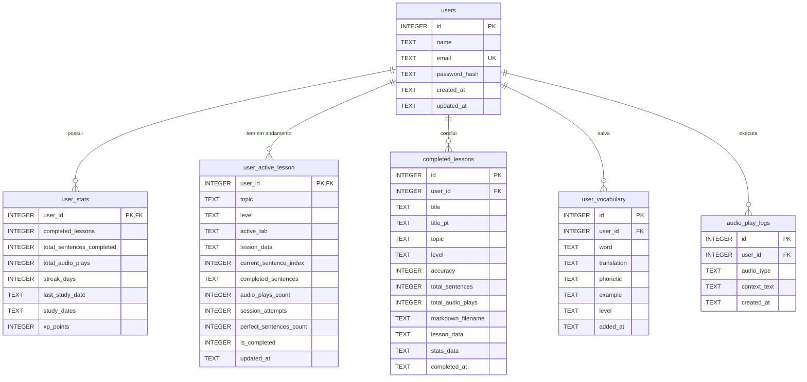

# SPEC: Plataforma de Estudos Diários de Inglês (FluencyFlow)

## 1. Visão Geral do Projeto

Plataforma web interativa para estudantes de inglês praticarem leitura contextual, compreensão auditiva (_listening_), ampliação de vocabulário e ditado guiado (_dictation_). A plataforma gera lições personalizadas sob demanda usando a API Google Gemini (`gemini-3.5-flash-lite` por padrão, configurável via `GEMINI_MODEL`), adaptadas ao nível CEFR (A, B ou C), estruturada como aplicação SaaS com autenticação oficial multiusuário, banco de dados SQLite persistente, retenção de progresso em tempo real e telemetria de reprodução de áudios.

---

## 2. Requisitos Atendidos & Funcionalidades

### 2.1. Autenticação Oficial & Gestão de Contas (SaaS SQLite)

- **Cadastro de Novos Usuários (`/api/auth/register`):**
  - Tela com alternância entre abas: **"Entrar na Conta"** e **"Criar Nova Conta"**.
  - Campos: Nome completo, E-mail, Senha e Confirmação de Senha.
  - Validação de formato de e-mail e requisito mínimo de 6 caracteres para senha.
  - Prevenção de duplicidade de e-mail com resposta amigável (`409 Conflict`).
- **Criptografia de Senhas (Bcrypt):**
  - Armazenamento 100% seguro de senhas com hash salgado usando `bcryptjs` (custo de 10 rounds). Nenhuma senha é salva em texto puro.
- **Login Oficial (`/api/auth/login`):**
  - Validação via SQLite comparando o hash bcrypt.
  - Geração de token de sessão seguro JWT (`Bearer token`) com validade configurável (30 dias).
  - Seed automático da conta administrativa definida no `.env` (`AUTH_EMAIL` / `AUTH_PASSWORD`) caso ainda não exista no banco.
- **Isolamento Multiusuário:**
  - Cada usuário autenticado possui seu próprio histórico de aulas concluídas, vocabulário pessoal, métricas de streak, XP, áudios ouvidos e lição ativa individual.

---

### 2.2. Persistência de Progresso em Tempo Real (Zero Perda no F5)

- **Problema Anterior:** Ao atualizar a página (`F5`), o React reinicializava o estado com a aula de exemplo (`STARTER_LESSON`) na aba de leitura, perdendo todas as frases já digitadas e respondidas no ditado.
- **Solução Implementada (Tabela `user_active_lesson`):**
  - Ao carregar a aplicação (`App.jsx`), uma requisição `GET /api/progress` busca a lição ativa do usuário logado no SQLite.
  - Se houver lição em andamento, o sistema restaura automaticamente:
    - O conteúdo completo da lição (`lesson_data`).
    - A aba ativa em que o usuário estava (`reading` ou `listening`).
    - O índice exato da frase atual (`current_sentence_index`).
    - A lista de sentenças já concluídas (`completed_sentences`).
    - O total de áudios escutados na lição (`audio_plays_count`).
    - O número de tentativas e frases perfeitas.
  - **Sincronização Contínua (`POST /api/progress`):**
    - Salva imediatamente ao mudar de aba, ao acertar uma frase do ditado e ao avançar no stepper.
    - Indicador visual na tela: *"💾 Progresso salvo no banco"*.
  - **Reinício e Limpeza (`DELETE /api/progress`):**
    - O usuário pode clicar em *"Recomeçar lição do início"* ou *"Gerar Nova Lição"*, limpando o progresso salvo e iniciando um novo ciclo de estudos.

---

### 2.3. Contabilização e Telemetria de Áudios (Tracking de Listening)

- **Problema Anterior:** Os áudios só eram contados localmente na memória RAM na aba de listening e apenas gravados se a aula fosse 100% terminada. Cliques de áudio em palavras soltas ou no texto de leitura não eram computados.
- **Solução Implementada (Tabela `audio_play_logs` + `user_stats`):**
  - Endpoint dedicado `POST /api/progress/audio` chamado em tempo real em qualquer reprodução de áudio:
    - **Listening:** Cada play/replay na sentença ou no player contínuo.
    - **Reading:** Reprodução do texto completo ou de expressões-chave.
    - **Word Tooltip:** Pronúncia de palavras individuais no balão de tradução.
  - Cada áudio reproduzido incrementa:
    1. O contador da lição ativa (`audio_plays_count`).
    2. O total vitalício do usuário no banco (`user_stats.total_audio_plays`).
    3. Concede **+2 XP** por áudio escutado (gamificação do listening).
    4. Grava registro auditável na tabela `audio_play_logs` (`audio_type`, `context_text`, `created_at`).
  - **Exibição na Interface:**
    - Badge no cabeçalho: `🎧 X áudios` atualizado em tempo real.
    - Badge de XP e nível gamificado.

---

### 2.4. Entrada de Assunto & Nível de Dificuldade

- **Tema Livre / Prompt:** Campo de texto onde o estudante digita qualquer assunto do seu interesse (ex.: _"Software Engineer Job Interview"_, _"Weekend trip to London"_).
- **Sugestões Rápidas de Temas:** Chips clicáveis com tópicos do cotidiano (_Morning Routine, Tech Interview, Airport & Travel, Ordering Food, AI Future of Work_).
- **Seletor de Nível CEFR:**
  - **Nível A (Básico / A1-A2):** Frases curtas, tempos verbais simples, vocabulário cotidiano.
  - **Nível B (Intermediário / B1-B2):** Phrasal verbs, conectivos, expressões idiomáticas e estruturas compostas.
  - **Nível C (Avançado / C1-C2):** Linguagem sofisticada, nuances formais/coloquiais e construções complexas.
- **Motor de IA:** Integração direta com Google Gemini utilizando `gemini-3.5-flash-lite` (override opcional com `GEMINI_MODEL`) através do pacote `@google/genai`.

---

### 2.5. Aba 1: Leitura Interativa (Reading & Vocabulary)

- **Texto Completo Formatado:** Exibição do texto gerado organizado em sentenças numeradas.
- **Tradução com Hover / Clique (Word Tooltip):**
  - Ao passar o mouse ou tocar em qualquer palavra em inglês, abre um balão (_popover_) com:
    - Tradução contextual para o português.
    - Transcrição fonética (IPA).
    - Botão de pronúncia em áudio da palavra individual (contabilizado no SQLite).
    - Botão de marcador (_Bookmark_) para salvar a palavra no Banco de Vocabulário pessoal.
- **Leitura em Voz Alta Contínua:** Botão "Ouvir Texto Completo" que lê o texto sequencialmente com destaque visual da sentença ativa.
- **Tradução Completa (Sanfona/Accordion):** Opção de revelar ou ocultar a tradução integral do texto em português.
- **Expressões-Chave & Vocabulário Destaque:** Cards com 3 a 5 phrasal verbs e expressões presentes no texto, com significado e exemplos práticos com áudio.
- **Botão de Transição Rápida:** Atalho no final da página para avançar direto ao treino de listening.

---

### 2.6. Aba 2: Listening & Ditado (Dictation Challenge)

- **Particionamento de Áudio:** O texto é fatiado em sentenças individuais com contador de progresso (ex.: _"Frase 1 de 5"_, barra de progresso visual).
- **Stepper de Navegação de Sentenças:** Pílulas interativas (`[1✓] [2✓] [3•]`) mostrando visualmente quais frases já foram validadas e permitindo navegar entre elas.
- **Player de Áudio por Sentença:**
  - Botão central grande de Play / Replay com contabilização instantânea no SQLite.
  - Animação de ondas sonoras durante a reprodução.
  - Controle de velocidade (0.75x, 1.0x, 1.25x).
  - Botão de "Pausar" e "Ouvir de Novo".
  - Atalhos de teclado (`Alt + P` ou `Ctrl + Espaço` para tocar / pausar, `Enter` para verificar).
- **Campo de Digitação do Ditado:**
  - O estudante ouve a frase e digita em inglês o que escutou.
- **Validação Inteligente & Flexível:**
  - Normaliza pontuações secundárias, aspas, espaços duplos e maiúsculas/minúsculas.
  - Exibe feedback colorido palavra por palavra:
    - 🟩 **Verde:** Palavras corretas.
    - 🟨 **Amarelo:** Quase lá (erro de digitação leve / typo detectado via distância de Levenshtein).
    - 🟥 **Vermelho / Tracejado:** Palavras faltantes ou incorretas.
- **Sistema de Dicas Progressivas (_Hints_):**
  - **Dica 1:** Revela estrutura e quantidade de palavras (`_ _ _`).
  - **Dica 2:** Revela a primeira letra de cada palavra.
  - **Dica 3:** Revela a sentença completa (para não travar os estudos).
- **Avanço de Etapa & Auto-Save:** Ao validar com sucesso, grava o progresso no SQLite e avança automaticamente para a próxima sentença até concluir 100%.

---

### 2.7. Finalização, Histórico e Gamificação

- **Gravação Automática em Banco e Disco:**
  - Ao terminar a última frase, dispara confetes celebratórios (`canvas-confetti`) e envia os dados via `POST /api/complete`.
  - Registra a lição na tabela `completed_lessons` vinculada ao usuário.
  - Gera arquivo Markdown na pasta `concluidos/` no formato `YYYY-MM-DD_HH-mm-ss_{slug}_level-{level}.md`.
  - Concede **+50 XP** bônus de conclusão de aula e atualiza o streak de dias consecutivos.
- **Modal de Histórico na Interface:** Permite visualizar as aulas concluídas pelo usuário e reler o conteúdo Markdown a qualquer momento.
- **Banco de Vocabulário Pessoal:** Armazenado na tabela `user_vocabulary` por usuário, com busca e **Modo Flashcards** (flip card com áudio).

---

## 3. Arquitetura do Banco de Dados SQLite (`sqlite/banco.db`)

O banco utiliza o módulo oficial de alto desempenho do Node 24 (`node:sqlite` - `DatabaseSync`), com modo **WAL (Write-Ahead Logging)** e chaves estrangeiras ativadas (`PRAGMA foreign_keys = ON;`).



---

## 4. Histórico de Decisões e Perguntas ao Usuário

| Pergunta / Solicitação do Usuário | Opções / Decisão | Implementação |
| --------------------------------- | ---------------- | ------------- |
| **Como salvar os dados de login e progresso?** | Arquivos JSON vs SQLite oficial | **SQLite Oficial (`sqlite/banco.db`)** nativo do Node.js (`node:sqlite`), sem dependências de C++ pesadas, rápido, transacional com WAL mode. |
| **Segurança das senhas no cadastro?** | Plain text vs Hash seguro | **Bcrypt com salt rounds = 10 (`bcryptjs`)**, garantindo proteção contra vazamentos de senhas e aderência a padrões comerciais. |
| **Como evitar perda de progresso ao dar F5?** | LocalStorage vs SQLite em tempo real | **Sincronização em tempo real via SQLite (`user_active_lesson`)**, restaurando aba, frase ativa, frases já respondidas e contador de áudios em qualquer reload ou dispositivo. |
| **Audios não contabilizados?** | Contar apenas no submit final vs Contar a cada play | **Telemetria de áudio instantânea (`POST /api/progress/audio`)**, gravando no banco a cada clique (listening, reading e tooltips) e somando XP ao perfil. |
| **Como gerar os áudios particionados de listening?** | Web Speech API nativa / Edge-TTS backend / Híbrido | **Web Speech API nativa** (sem delay, sem latência de rede, controle instantâneo de velocidade, suporte a vozes US/UK). |
| **Qual o nível de rigor na validação do listening?** | Validação flexível com dicas / Validação estrita | **Validação flexível com dicas** (ignora pontuação e maiúsculas, destaca erros de digitação leves em amarelo via Levenshtein e faltantes em vermelho). |
| **Formato de armazenamento das aulas concluídas?** | Markdown (.md) na pasta concluidos/ + SQLite | **Dupla persistência:** Salva no SQLite para consulta rápida e gera arquivo `.md` em `concluidos/` para leitura e backup pessoal. |

---

## 5. Estrutura de Pastas e Arquivos

```
english-plataform/
├── .env                       # GEMINI_API_KEY, GEMINI_MODEL (opcional), AUTH_EMAIL, AUTH_PASSWORD, JWT_SECRET, PORT
├── package.json               # Dependências raiz (express, bcryptjs, @google/genai, cors, etc.)
├── SPEC.md                    # Esta especificação técnica completa
├── concluidos/                # Arquivos .md das aulas finalizadas
│   └── 2026-10-03_..._level-A.md
├── sqlite/
│   ├── banco.db               # Banco de dados SQLite persistente oficial
│   └── generate_db.js         # Script utilitário para checagem e setup do schema
├── server/
│   ├── index.js               # Servidor Express, rotas protegidas e fallback estático
│   ├── db.js                  # Camada de dados SQLite (CRUD de usuários, progresso, stats, vocabulário)
│   ├── gemini.js              # Serviço de geração via Google Gemini (Flash-Lite padrão)
│   └── storage.js             # Gestão de arquivos físicos em concluidos/
└── client/
    ├── index.html             # HTML raiz com Google Fonts (Inter)
    ├── vite.config.js         # Configuração Vite com Tailwind CSS e proxy /api -> :8072
    └── src/
        ├── App.jsx            # Componente raiz, orquestrador de sessão e restauração de progresso
        ├── index.css          # Estilos Tailwind CSS
        ├── components/
        │   ├── LoginScreen.jsx      # Tela de login e cadastro com validação e segurança bcrypt
        │   ├── Header.jsx           # Perfil do usuário, Streak, Áudios (🎧), XP, Abas, Voz e Logout
        │   ├── GeneratorBar.jsx     # Gerador com tema livre, chips rápidos e seletor CEFR A/B/C
        │   ├── ReadingTab.jsx       # Leitura com tooltips, áudio contínuo e logging de reprodução
        │   ├── ListeningTab.jsx     # Ditado interativo, stepper de sentenças, player e auto-save
        │   ├── WordTooltip.jsx      # Tradução flutuante, fonética e áudio individual
        │   ├── HistoryModal.jsx     # Visualizador das aulas salvas pelo usuário
        │   └── VocabularyModal.jsx  # Vocabulário pessoal com modo Flashcards
        └── utils/
            ├── diff.js              # Normalização, distância Levenshtein e dicas progressivas
            └── speech.js            # Wrapper Web Speech API (US/UK, velocidade e cancelamento de áudio)
```

---

## 6. Endpoints da API (Backend Express na porta 8072)

| Método   | Endpoint                 | Autenticação | Descrição |
| -------- | ------------------------ | :----------: | --------- |
| `GET`    | `/api/health`            | Aberto       | Healthcheck do servidor Express |
| `POST`   | `/api/auth/register`     | Aberto       | Cria nova conta com nome, email e senha hasheada com bcrypt |
| `POST`   | `/api/auth/login`        | Aberto       | Autentica usuário via SQLite/bcrypt e retorna JWT |
| `GET`    | `/api/auth/verify`       | Bearer JWT   | Valida sessão e retorna dados do usuário autenticado |
| `GET`    | `/api/progress`          | Bearer JWT   | Recupera lição em andamento, frases concluídas e áudios |
| `POST`   | `/api/progress`          | Bearer JWT   | Atualiza e persiste o progresso da lição no SQLite |
| `DELETE` | `/api/progress`          | Bearer JWT   | Limpa lição em andamento ao recomeçar ou gerar nova |
| `POST`   | `/api/progress/audio`    | Bearer JWT   | Registra reprodução de áudio, incrementa stats e soma XP |
| `POST`   | `/api/generate`          | Bearer JWT   | Gera lição via Google Gemini (`{ topic, level }`) |
| `POST`   | `/api/complete`          | Bearer JWT   | Grava lição concluída no SQLite e em arquivo Markdown |
| `GET`    | `/api/history`           | Bearer JWT   | Lista histórico de aulas concluídas do usuário logado |
| `GET`    | `/api/history/:filename` | Bearer JWT   | Lê conteúdo Markdown da aula selecionada |
| `GET`    | `/api/stats`             | Bearer JWT   | Retorna estatísticas completas (streak, aulas, áudios, XP) |
| `GET`    | `/api/vocabulary`        | Bearer JWT   | Retorna banco de vocabulário do usuário |
| `POST`   | `/api/vocabulary`        | Bearer JWT   | Adiciona palavra ao vocabulário do usuário |
| `DELETE` | `/api/vocabulary/:word`  | Bearer JWT   | Remove palavra do vocabulário do usuário |

---

## 7. Como Executar

### 1. Requisitos
- Node.js v22+ (ou v24 recomendado, já com `node:sqlite` nativo).
- Chave de API Google Gemini no arquivo `.env`.

### 2. Configuração do `.env`
```env
PORT=8072
GEMINI_API_KEY=sua_chave_gemini_aqui
# GEMINI_MODEL=gemini-3.8-flash
AUTH_EMAIL=admin@fluencyflow.com
AUTH_PASSWORD=senha_inicial_admin
JWT_SECRET=fluency_super_secret_jwt_token_key_saas_2026
```

### 3. Modo Desenvolvimento (Hot-Reloading):
```bash
npm run dev
```
Inicia simultaneamente:
- Servidor backend Express na porta `http://localhost:8072`.
- Servidor Vite com React na porta `http://localhost:5173`.

### 4. Modo Produção / Servidor Único:
```bash
npm run build
npm start
```
Compila o cliente React para `client/dist` e serve tudo diretamente pelo Express em `http://localhost:8072`.

---

## 8. Modelo Gemini: latência na geração de lições

### Problema

A geração de lições via `gemini-3.8-flash` tendia a demorar mais do que o desejado na experiência do estudante, especialmente porque o prompt exige JSON extenso (texto completo, tradução, palavra a palavra com IPA e expressões-chave).

### Solução

- Padrão alterado para **`gemini-3.5-flash-lite`** em [`server/gemini.js`](server/gemini.js), linha de modelo lida de `process.env.GEMINI_MODEL` com fallback para esse ID.
- **Rollback sem alterar código:** definir `GEMINI_MODEL=gemini-3.8-flash` no `.env`.
- **Riscos:** modelos Lite podem falhar ocasionalmente em JSON estruturado ou reduzir qualidade de IPA/traduções no nível C; monitorar erros de parse e qualidade pedagógica.
- **Próximo passo se ainda estiver lento:** reduzir volume de saída no prompt (ex.: IPA só em palavras difíceis), independentemente do modelo.


---

## 9. Adaptação Mobile & Otimização de Performance (Outubro 2026)

### 9.1. Problema Identificado
- **Overflow de Elementos:** Em telas de dispositivos móveis (320px – 480px), cabeçalhos, marcadores de sentenças no ditado, formulários de geração e modais ultrapassavam a largura do viewport, causando rolagem horizontal incômoda.
- **Lentidão / Lag em Mobile:** A rolagem da aba de leitura no celular travava constantemente. O balão de tradução de palavras (_WordTooltip_) saía das margens da tela quando acionado em palavras próximas às bordas superior ou laterais.

### 9.2. Solução Implementada

1. **Layout Responsivo Mobile-First:**
   - **`client/index.html`**: Configurada meta tag de viewport com `viewport-fit=cover`.
   - **`client/src/index.css`**: Adicionada proteção global `overflow-x: hidden` no `html, body` e utilitário `.no-scrollbar`.
   - **`Header.jsx`**: Reorganizado em estrutura adaptativa (Linha 1: Logo e Perfil do Usuário; Linha 2: Alternador de Abas de largura total; Linha 3: Barra com rolagem horizontal suave para estatísticas de `🎧 Áudios`, `🔥 Streak` e `⚡ XP`).
   - **`ListeningTab.jsx`**: Stepper de sentenças convertido para contêiner de rolagem horizontal touch. Botões de ação adaptados para empilhamento vertical em mobile (`w-full sm:w-auto`). Dicas de teclado desktop ocultadas em telas menores.
   - **`GeneratorBar.jsx` & Modais (`VocabularyModal`, `HistoryModal`)**: Cards de nível CEFR, inputs de IA e flashcards totalmente responsivos com suporte a alternância de coluna e botão de voltar em smartphones.

2. **Prevenção de Estouro de Tela no Popover (`WordTooltip.jsx`):**
   - Implementada trava dinâmica de limites (`clampedLeft` restrito entre `12px` e `window.innerWidth - 12px`).
   - Adicionada detecção de proximidade do topo (`position.top < 140px`) com inversão automática da seta e posicionamento do balão abaixo da palavra quando necessário.

3. **Otimizações de Performance Mobile:**
   - **Remoção de `onMouseEnter` no `ReadingTab.jsx`:** O evento `onMouseEnter` em cada palavra individual causava múltiplos cálculos de `getBoundingClientRect()` e renderizações desnecessárias durante o gesto de scroll em telas sensíveis ao toque. A interação foi unificada exclusivamente para `onClick`/`onTouch`, eliminando o gargalo de rolagem.
   - **Gestão Eficiente da Web Speech API (`speech.js`)**: Implementado armazenamento em cache da lista de vozes sintetizadas e cancelamento gracioso de execução para evitar travamentos da main thread no Safari iOS e Chrome Android.

### 9.3. Validação
- **Qualidade de Código (`oxlint`):** Executado `cd client && npx oxlint src` com 0 erros.
- **Compilação de Produção (`vite build`):** Executado `npm run build` com sucesso gerando assets otimizados.
